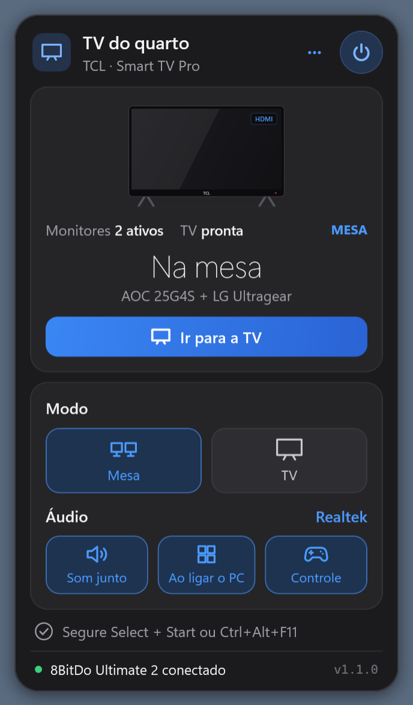
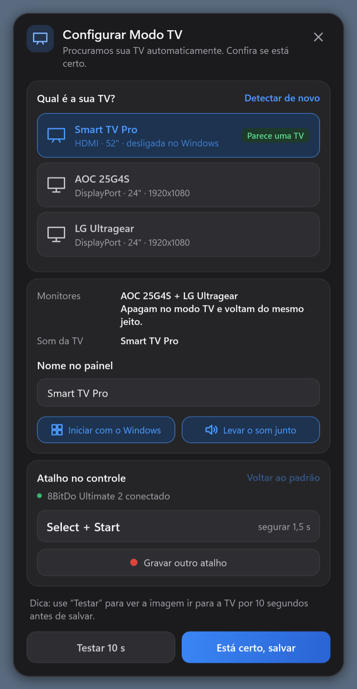

# Modo TV

Use o PC como console na TV com um botão do controle. No modo TV, os monitores da mesa apagam, a TV vira a única tela (os jogos abrem nela) e o som vai junto. Segure o mesmo atalho de novo e tudo volta como estava.



## O que ele faz

- **Troca de telas:** liga só a TV como tela principal e desliga os monitores; na volta, restaura a mesma disposição e o monitor principal.
- **Janelas no lugar:** guarda onde cada aplicativo estava (inclusive maximizado em outro monitor) e devolve cada um ao seu lugar na volta.
- **Mesa protegida:** ao ligar a TV, o Windows costuma reativá-la como tela estendida e mandar o som para ela; no modo mesa, o app desfaz isso sozinho.
- **Som junto:** troca a saída de áudio para a TV e devolve a anterior na volta.
- **Atalho no controle:** segure por 1,5 s. O padrão é Select + Start (View + Menu no Xbox, Create + Options no PlayStation), e dá para gravar qualquer combinação de 2 ou mais botões.
- **Teclado:** Ctrl+Alt+F11.
- **Resolução na TV:** escolha entre a mais nítida e a mais fluida que a sua TV oferece (ex.: 4K 60 Hz ou 1440p 120 Hz).
- **Painel na bandeja** com o estado das telas, som, controle e resolução.
- **Atualização pelo GitHub:** quando sai uma versão nova, aparece um aviso perto do relógio, um ponto verde no ícone e o botão **Atualizar** no painel. Ele baixa a versão certa (leve ou portátil), troca o arquivo e reabre o app.

## Configuração automática

Na primeira vez que abre, o app procura a TV e mostra o que encontrou para você confirmar:

- pontua cada tela por conexão HDMI, "TV" no nome, tamanho (lido do EDID) e marca;
- acha a saída de áudio da TV pelo nome;
- tem um botão **Testar 10 s** que leva a imagem para a TV e volta sozinho;
- só salva quando você clica em **Está certo, salvar**.



## Controles suportados

| Controle | Como é lido |
|---|---|
| Xbox, 8BitDo e outros no modo X-input | XInput |
| DualSense, DualSense Edge, DualShock 4 (USB e Bluetooth) | HID direto |

Funciona com a Steam aberta ou fechada. Controles no modo Switch/D-input ainda não são reconhecidos.

## Se algo não funcionar

O app registra cada troca e cada erro em `%LOCALAPPDATA%\ModoTV\modotv.log`.

- **Depois de reinstalar o driver de vídeo**, o Windows esquece as configurações de tela. O app liga a TV pelo método clássico (GDI) e depois a deixa como única tela; não é preciso fazer nada.
- **Só aparece 60 Hz na resolução:** a TV não está anunciando 120 Hz. Ative o modo HDMI 2.1 / avançado dessa entrada nas configurações da TV, desligue e ligue a TV e entre uma vez no modo TV.
- **O atalho do controle não responde:** confira se o controle está ligado e, no caso do 8BitDo, no modo X-input.

## Desempenho

Feito em C#/.NET 8 com APIs do próprio Windows (CCD para telas, Core Audio para som, XInput e HID para controles). Sem serviços, sem navegador embutido. Parado na bandeja, usa cerca de 50 MB de memória e nada de CPU; as animações do painel duram menos de 0,25 s e só rodam com ele aberto. A procura por atualização é uma única requisição ao GitHub ao abrir e a cada 12 horas.

## Compilar

Requer o .NET 8 SDK no Windows 10/11.

```bash
dotnet publish ModoTV/ModoTV.csproj -c Release -r win-x64 --self-contained false -p:PublishSingleFile=true -o dist
```

Versão portátil, sem precisar do .NET instalado (~68 MB):

```bash
dotnet publish ModoTV/ModoTV.csproj -c Release -r win-x64 --self-contained true -p:PublishSingleFile=true -p:EnableCompressionInSingleFile=true -o dist/portatil
```

## Linha de comando

`ModoTV.exe tv | mesa | toggle | status | teste | diag | atualizar`

- `status`: lista telas, áudio, controle e qual tela parece ser a TV.
- `teste`: vai para a TV por 10 s e volta.
- `diag`: pergunta ao Windows se aceitaria a troca, sem mudar nada na tela.
- `atualizar`: procura e instala a versão nova do GitHub.

A configuração fica em `%LOCALAPPDATA%\ModoTV\config.json`.

## Licença

Copyright (C) 2026 kekelxd

[GPL-3.0](LICENSE): você pode usar, estudar, modificar e redistribuir o Modo TV, desde que versões modificadas distribuídas também sejam GPL-3.0 com o código-fonte aberto. O software é fornecido sem garantia.
